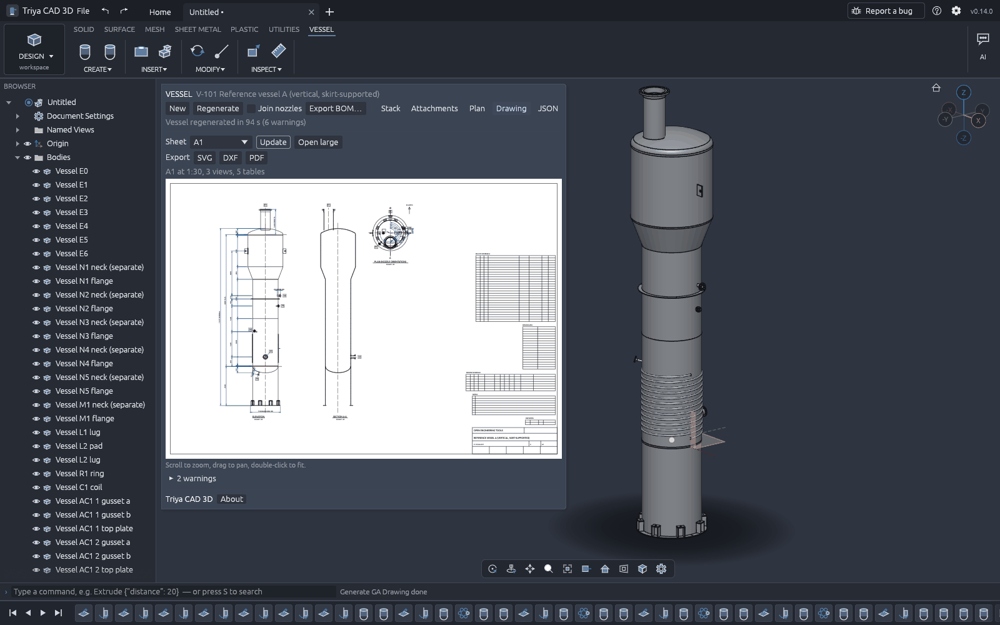
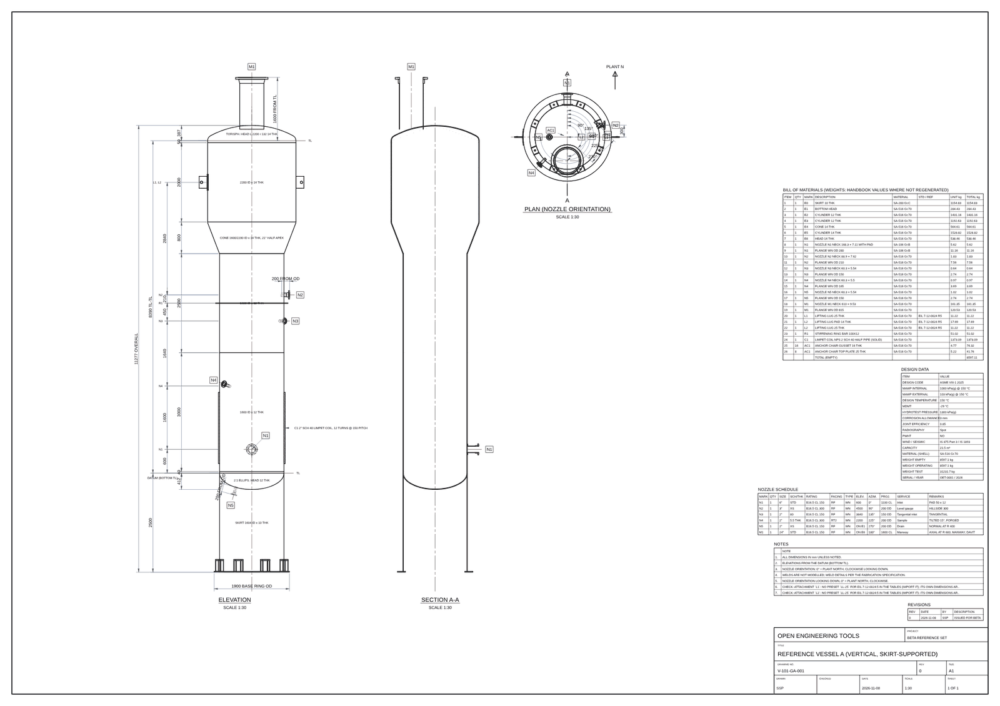

# Triya CAD 3D

Parametric 3D CAD in the browser for pressure-vessel and static-equipment engineers, with a
parametric vessel builder (shell courses, heads, cones, skirts, nozzles with ASME B16.5/B16.47
flanges, saddles, legs, brackets, rings, limpet coils, lugs) and automatic fabrication (GA)
drawings. Part of [Open Engineering Tools](https://openengtools.com). Installable PWA, works
offline, no login, no cookies.

> **Based on [SolidCraft](https://github.com/tangency-labs/solidcraft) v0.14.0**, © SolidCraft
> contributors, MIT OR Apache-2.0. Triya CAD 3D is an independent project and is not affiliated
> with or endorsed by the SolidCraft project. See [NOTICE](NOTICE).

**Status:** beta candidate `0.1.0-beta` (target 8 Nov 2026). What is done and what is still open
is in [`triya/PROGRESS.md`](triya/PROGRESS.md) and the checklist [`triya/docs/beta-dod.md`](triya/docs/beta-dod.md).





## What you get
- Everything SolidCraft 0.14 does: sketcher with constraints, parametric timeline, extrude /
  revolve / sweep / loft / shell / fillet / patterns / assemblies, STEP AP242 & IGES I/O, MCP
  server for AI agents, desktop and web.
- **VESSEL tab and Vessel panel**: a vessel is an ordered element stack (skirts, heads of every
  common preset, shell courses, cones, body flanges) plus attachments (nozzles and manways with
  ASME B16.5/B16.47 flanges, saddles, legs, brackets, lugs, rings, limpet coils), positioned from
  a selectable datum. Every dimension becomes a named user parameter (`V<vessel>_<element>_<field>`).
  Standards tables carry per-row provenance; company tables can be imported privately.
- **GA drawing**: one click builds an A0–A4 sheet from the vessel model (elevation, plan,
  section A–A with hatching, stacked tangent-line dimensions, nozzle schedule, BOM with weights,
  design-data block, notes, revisions, title block) and exports it as SVG, DXF or PDF.
- **Agent-friendly**: every vessel and drawing operation is a command reachable from the panel,
  JSON scripts, the CLI and MCP (`vessel.new`, `vessel.set`, `vessel.regenerate`, `vessel.bom`,
  `drawing.generate_ga`, `drawing.export`, …). Run `triya-cli commands` for the full list.

## Quick start
**Web:** open <https://shubhs650.github.io/triya-cad-3d/app/> (once GitHub Pages is enabled for
the repository), then *Install app* from the File menu; it works offline after the first load.
`…/app/?vessel=a` (or `b`, `c`) opens a reference vessel; add `&regenerate` to build it at once.

**Model a vessel** (desktop or web):
1. Open the **VESSEL** tab; in the Vessel panel on the left click **New** (a one-course vessel).
2. On the **Stack** page add heads, courses and cones; type diameters, thicknesses and lengths.
   Changing a shell ID carries down the stack until a cone.
3. On the **Attachments** page add nozzles and supports, pick the host in the 3D view and set the
   position from the datum, the angle (Plant North, clockwise) and the size (NPS, class, schedule).
4. Click **Regenerate**. *Join nozzles* cuts each nozzle into its shell, which takes minutes a
   nozzle in this kernel; leave it off for a quick look (nozzles as separate bodies).
5. On the **Drawing** page click **Generate**, check the preview, then export SVG, DXF or PDF.
6. Save with Ctrl+S (a `.solidcraft` file: the vessel and the sheet settings are inside it).

The JSON page shows the whole vessel document; the same JSON can be pasted into `vessel.new`
from a script or an AI agent. Reference vessels: `triya/crates/triya-vessel/tests/reference/`.

**Build it yourself:**
```bash
rustup target add wasm32-unknown-unknown && cargo install trunk --version 0.21.14 --locked
cd triya/apps/triya-web && trunk serve        # http://127.0.0.1:8782
cargo run --release -p triya -- --sample      # desktop app
```
Headless: `cargo run -p triya-cli -- run triya/crates/triya-vessel/examples/vessel-a-shell.json --out vessel.step`
(`triya-cli` is upstream's CLI with the `vessel.*` and `drawing.*` commands registered). For AI
agents: `cargo run -p triya-cli -- mcp` (MCP server on stdio, reports itself as `triya-cad-3d`).

## Repository layout
Upstream SolidCraft lives in `crates/`, `apps/`, `xtask/`, … and is modified only at the one-line
seams listed in [`triya/patches/PATCHES.md`](triya/patches/PATCHES.md). Everything Triya adds is
under [`triya/`](triya/): crates `triya-brand`, `triya-stdlib`, `triya-vessel`, `triya-drawing`,
`triya-ui`; apps `triya-web` (PWA), `triya` (desktop), `triya-cli` (headless + MCP); plan, ADRs and
docs. Read
[`triya/ARCHITECTURE.md`](triya/ARCHITECTURE.md) first.

## Limitations (beta)
- **Regeneration is slow when nozzles are joined.** The B-rep kernel (truck, frozen upstream)
  needs minutes for some nozzle booleans. Reference vessel A's shell regenerates in about 6 s in
  Chrome (2 s native); with its 6 nozzles and 5 supports built as separate bodies it takes about
  1.5 min in Chrome (41 s native), and with the nozzles joined about 7 min natively and 24 min in
  Chrome (`triya/PROGRESS.md`, "Measurements"). The desktop app regenerates in the background
  with a progress bar; the browser holds the window while it runs, so *Join nozzles* is off there
  by default. When a boolean fails or measures wrong, the nozzle is kept as a separate body and
  flagged.
- **No fillets on curved edges**: knuckles are exact profile arcs; welds are drawn on the sheet,
  not modelled. The limpet coil is a solid rod; 2:1 head outsides are ~3 % thin between crown and
  equator.
- **DXF dimensions are exploded** into lines and text on the `DIM` layer (no DIMENSION entities).
  The PDF uses the built-in Helvetica (Latin text only).
- **No proprietary standard sheets**: EIL and other company or paid standard tables are not
  included and never will be; import your own (`vessel.import_tables`, see
  `triya/docs/standards-library.md`). Shipped rows say where they came from and whether they were
  checked against two sources; verify against the current edition before use.
- No pressure-vessel code calculations and no compliance verdicts.
- Heat exchangers, generic drawings of arbitrary parts and meshing are post-beta (`triya/PLAN.md`).

## FAQ
**Why are files `.solidcraft`?** On purpose: a design saved by Triya opens in unmodified SolidCraft
with all its geometry (the vessel is built from ordinary sketches and features; the vessel JSON
rides along in the file's metadata), and SolidCraft's designs open in Triya. Checked by
`triya/ci/upstream-roundtrip.sh`.

**Can I edit the geometry by hand?** Yes, it is an ordinary parametric timeline. Regenerate
replaces only the features the last regeneration made (the `Vessel <id>` folder).

## Brand assets
The Triya mark is drawn in code (`triya/crates/triya-brand/src/mark.rs`); the web icons are exports
of it, each with a row in [`ATTRIBUTION.md`](ATTRIBUTION.md). No SolidCraft or third-party artwork is
used for Triya's branding. The screenshots in `triya/docs/img/` are of Triya itself.

## Licence and attribution
MIT OR Apache-2.0, at your option — both for the upstream code and for Triya's additions.
Triya CAD 3D is based on SolidCraft v0.14.0 (© SolidCraft contributors, MIT OR Apache-2.0); see
[NOTICE](NOTICE). Every asset and data table has a row in [`ATTRIBUTION.md`](ATTRIBUTION.md)
(source, licence, what was derived); third-party crate licences are in `THIRD-PARTY-LICENSES.txt`.
No GPL/LGPL/AGPL code is used, and nothing comes from commercial CAD products. Data
tables carry per-row provenance; verify against the current standard edition before use. This
software performs no pressure-vessel code calculations and prints no compliance verdicts.
